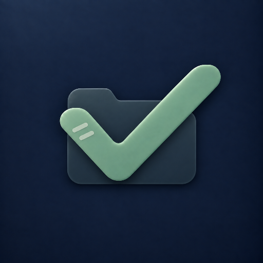

<div align="center">
    
    <h1>TaskDock</h1>
</div>

<p align="center">
    <em>把散落的任务，放回它该在的位置。</em>
</p>

<p align="center">
    <a href="https://taskdock.igng.net/">官网</a> ·
    <a href="https://github.com/IGNGserver/taskdock/releases">下载</a> ·
    <a href="docs/DEPLOYMENT.md">部署文档</a>
</p>

<p align="center">
    <a href="https://github.com/IGNGserver/taskdock/releases"></a>
    
    
    
</p>

TaskDock 是一个给自己用的任务工作台，跑在你自己的服务器上。想法先记下来，再用目录、日期、流程和步骤把它安排明白，每个任务都能附上一份 Markdown 笔记。中枢放在 NAS、家用服务器或云主机上，浏览器和 Android 手机连过去用；断网时照样能看能改，连上以后再同步。数据只落在你自己的 PostgreSQL 里，没有托管后端，也没有团队和权限那一套。

## 功能

- **一个任务，只有一个事实**：目录决定它放在哪，日期和事件决定什么时候关注它，流程记录它走到哪一步，步骤拆开具体怎么做。四个维度互相独立，指的却始终是同一个任务——任何一处改了状态，其它视图跟着变，不会出现两份对不上的副本。
- **目录树**：文件夹可以一直嵌套，同一层里文件夹和任务并排。文件夹没有自己的状态，由里面所有任务实时推导出来。
- **日期和事件**：同一个任务能同时出现在好几天，也能挂在「额度重置后」「上线前」这种还没定日期的事件上。安排只是一条引用，完成一次、处处完成；把某天没做完的安排批量顺延到第二天，随时能撤销。
- **流程看板**：把任务放进分阶段的流程里。一个任务可以同时属于几个流程，但在同一个流程里只出现一次。
- **执行步骤**：在任务内部列出线性的步骤，每一步有三态状态，不会反过来改动任务本身。
- **Markdown 笔记**：思路、命令、链接和处理过程都写在任务下面，不用另开一个地方记。
- **归档按次恢复**：归档一个文件夹会连子目录一起归档；恢复时只恢复那一次操作归档的内容，不会把更早归档的任务一起捞回来。
- **不变的任务编号**：新任务是 `TASK-` 加全局序号，创建后不再改变，写进笔记或提交信息里也不会失效。
- **常用的小动作**：桌面浏览器按 `⌘ K` / `Ctrl K` 打开命令面板搜任务和笔记；手机浏览器右滑完成任务，左滑展开操作。

## 离线优先

界面先读本地数据，不等网络。浏览器用 IndexedDB，Android 用 Room，打开就能用。

- 每次修改和它的待同步记录写在同一个本地事务里，恢复连接后按顺序推送，再拉取别的设备的变化。
- 同一条修改重试不会重复写入。
- 版本对不上时不会静默覆盖：你的修改和服务器的版本会同时保留，由你决定怎么处理。
- 整棵目录删除、批量顺延这类不好回退的操作，离线时直接拒绝。
- 实时连接只用来提醒「有东西要同步」，任务内容不走这条通道。

## 多端

- **网页 / PWA**：中枢启动后用浏览器打开 `APP_ORIGIN` 就能用，不用另装客户端。界面按屏幕自适应：手机单手记录，平板双栏，桌面支持拖放和键盘操作。HTTPS 下可以安装为 PWA 并离线打开。
- **Android**：原生 Jetpack Compose 客户端，Room 本地存储，和网页端共用一套 API 与同步协议。APK 附在每个 Release 里。
- **中枢**：Fastify + PostgreSQL 组成的单用户服务端。所有设备的数据最终汇集在这里，也只在这里。

## 下载与部署

先部署中枢，再从任意设备打开。

**中枢（Docker）**：镜像发布在 GitHub Container Registry，服务器上不需要源码，也不需要 Node.js，装好 Docker 和 Docker Compose 就够了。

```bash
# 1. 空目录里准备 compose.yaml 和 .env.example
cp .env.example .env
# 2. 生成随机密钥，填写 .env（APP_ORIGIN、POSTGRES_PASSWORD、令牌密钥、Owner 账号）
openssl rand -base64 48
# 3. 用要部署的版本启动，版本号见 Releases
export APP_VERSION=2.0.0-rc.66
docker compose pull
docker compose --profile operations run --rm migrate
docker compose up -d
curl -fsS http://127.0.0.1:48731/health/ready
# 4. 首次部署时初始化 Owner 账号
docker compose --profile operations run --rm bootstrap
```

默认只有服务器本机能访问 `http://127.0.0.1:48731`。要让其他设备打开，二选一：把 `.env` 里的 `TASKDOCK_BIND_ADDRESS` 改成 `0.0.0.0`（明文 HTTP，仅限可信网络），或在 `APP_ORIGIN` 填好域名后执行 `docker compose --profile gateway up -d`，由 Caddy 提供 HTTPS 入口。初始化成功后建议从 `.env` 里删掉 `OWNER_PASSWORD`，并删除或轮换 `BOOTSTRAP_TOKEN`。

**网页端**：中枢起来后，浏览器打开你配置的 `APP_ORIGIN` 即可，无需安装。

**Android**：APK 在 [GitHub Releases](https://github.com/IGNGserver/taskdock/releases) 里，文件名形如 `TaskDock-<版本>-android.apk`。登录时填中枢地址、用户名和密码。

**升级**：先按 [备份与恢复](docs/BACKUP_RESTORE.md) 做一份备份，再把 `.env` 里的 `APP_VERSION` 改成新版本，重复 `pull` / `migrate` / `up -d`。出问题时把版本号改回去，并按备份文档处理数据库。

完整的变量说明、外部 PostgreSQL、Caddy 网关和回滚步骤在[部署说明](docs/DEPLOYMENT.md)里。

## 版本

TaskDock 现在处于 **2.0 预览阶段**，发出来的都是预发布版本（例如 `2.0.0-rc.66`）。每个版本有自己的镜像标签，推上去以后不会再改。

- `latest` 只跟随**正式稳定版**，目前还停在 `0.1.x`；想在 v2 上使用就写明确的版本号。
- 预发布版不会覆盖 `latest`，也不会因为构建成功就自动转正。
- 每次发布都会在 Release 里用中文写清更新内容、已知问题和附带文件。

细节见[发布规范](docs/RELEASING.md)。

## 数据与安全

- 任务、安排和笔记保存在自托管中枢的 PostgreSQL 里；默认 Compose 不把数据库端口映射到宿主机。
- 应用端口默认只绑定 `127.0.0.1`，要直连 HTTP 得显式设置 `TASKDOCK_BIND_ADDRESS=0.0.0.0`；公网请走 HTTPS。
- 密码至少 6 位，6 位纯数字也可以，没有字符种类限制。
- 用 HTTP 也能访问，但界面会提示这是明文传输，密码和会话信息不做加密。可信局域网可以接受，公网不建议。
- 密钥、数据库口令只放在 `.env` 里，不要提交到仓库。

用于重要数据之前，请先读[安全说明](docs/SECURITY.md)和[备份与恢复](docs/BACKUP_RESTORE.md)。

## 文档

- [部署说明](docs/DEPLOYMENT.md)——环境变量、首次部署、升级与回滚、Caddy 网关
- [外部 PostgreSQL](docs/EXTERNAL_DATABASE.md)——接现有数据库、共享数据库服务器
- [备份与恢复](docs/BACKUP_RESTORE.md)
- [安全说明](docs/SECURITY.md)——认证、限流、代理信任、密钥处理
- [同步协议](docs/SYNC_PROTOCOL.md)——离线队列、冲突处理、游标
- [发布规范](docs/RELEASING.md)——版本号、预发布与稳定版的区别
- [更新日志](CHANGELOG.md)——每个版本改了什么

## 许可证

仓库尚未附上开源许可证，在正式分发前请先补齐许可证文件。
